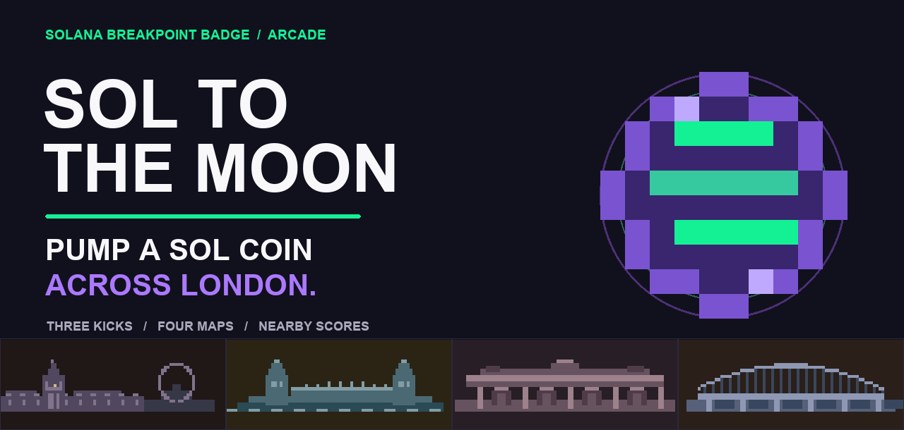
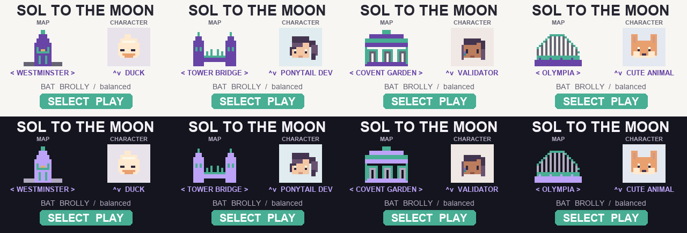

# SOL TO THE MOON

**PUMP a SOL coin across London. Three kicks, four maps, nearby scores.**

Pick a character. Hold SELECT to drop the coin and charge. Release near the bat. Send it flying across Westminster, Tower Bridge, Covent Garden or Olympia.

*Original game-art studies, not photos or captures from the physical badge.*

**3 kicks** per run · **4 London maps** · **nearby best scores** over badge mesh

**Rewards proposed:** 600 m earns 1 !LAMP, 800 m earns up to 5 !LAMPs, with a target limit of 20 !LAMPs per player each UTC day. **Not active:** DevRel must approve and set the server-side cap. Nearby scores never determine rewards.

[Playtest on the badge](https://solana.com/breakpoint/badge/apps/submit) · [How it works and release status](docs/DEVREL.md) · [Store copy](docs/STORE_COPY.md)

Controls, build and status

- **Menu:** LEFT/RIGHT map, UP/DOWN character, SELECT play.
- **Kick:** after the short intro, release SELECT once. Press and hold it again to start the drop and charge, then release near the bat. CANCEL pauses play and quitting asks for confirmation. The OS HOME key cannot be intercepted.
- **Results:** DOWN selects the next bat, UP shows nearby ranks, SELECT replays. Ranks are self-reported by nearby badges running this app: not Yearbook, not a global or verified-friends leaderboard.
- **App:** `moonshot` v1.0.3 · Lua 5.5 · Solana OS · ESP32-C5. Upload `main.lua` and `app.json` only, or the matching local `dist/` ZIP. Run the emulator and the USB badge test before publishing.
- **Validation:** headless Lua simulations cover controls, game flow, rewards and physics (`python sim.py`, `sim_controls.py`, `sim_final_controls.py`, `sim_rewards.py`, `sim_transition.py`, `calib.py 10`). Physical badge, two-badge mesh and App Store publication remain unverified.

